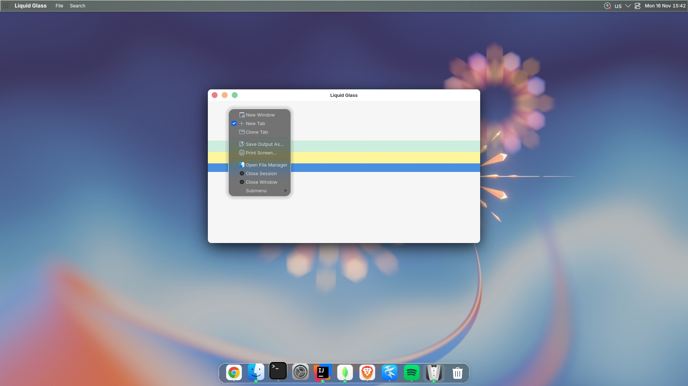
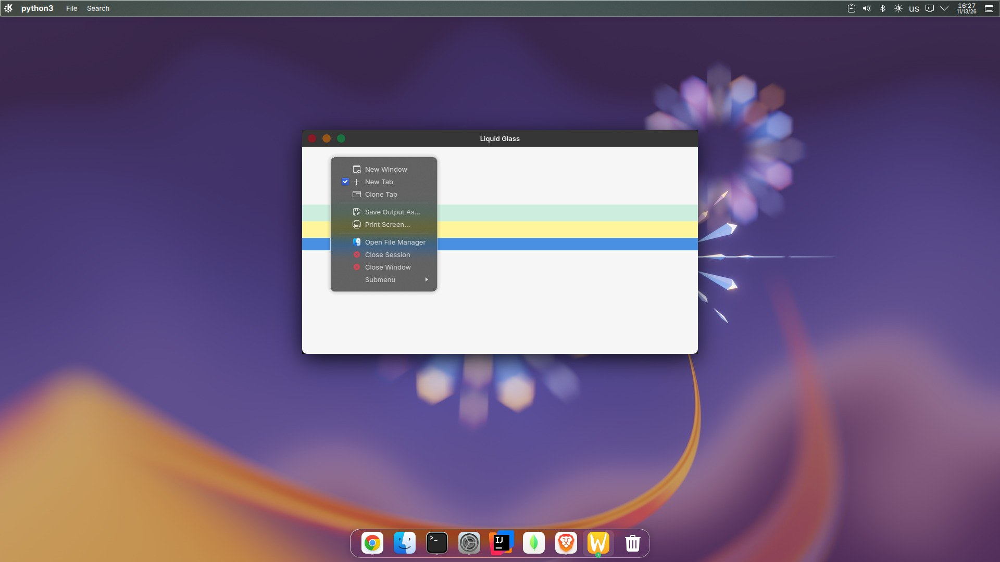

# plasma-liquid-glass

A "liquid glass" look for KDE Plasma 6 on top of the [WhiteSur](https://github.com/vinceliuice/WhiteSur-kde) theme:
see-through dock, top bar and popups with lens refraction, a thin rim light, 20px corners, and separate light and
dark tuning.

| Light | Dark |
|---|---|
|  |  |

It is made of three parts:

- **A KWin effect** — a [fork of Better Blur DX](https://github.com/artyommargaryan/kwin-effects-better-blur-dx/tree/glass)
  that adds the glass lens, rim light, dock blur and backdrop dimming. Built from source by the installer.
- **Theme files** — replacement dock/top-bar and popup artwork for the WhiteSur and WhiteSur-dark Plasma themes
  (thin tints, 20px corners, matching blur masks and shadows).
- **Scripts** — light/dark switching that keeps a set of glass values per mode, a login check for KWin updates,
  and a one-command rebuild.

## Status

Built and tested on **one machine**: Fedora 44, Plasma/KWin 6.8.2, Wayland, two 1080p screens. The installer's file
and settings steps are also tested against an empty home directory, and the `--layout` panel script in a separate
nested Plasma session; the full install on a second machine is not.
Other distributions should work but need their build dependencies installed by hand. X11 is untested.

## Requirements

- KDE Plasma 6 on Wayland
- The WhiteSur Plasma themes (`WhiteSur` and/or `WhiteSur-dark`) from [WhiteSur-kde](https://github.com/vinceliuice/WhiteSur-kde)
- `git`, `cmake`, a C++ compiler and the KWin development packages (the installer installs these on Fedora)
- `qdbus-qt6` (Fedora: `qt6-qttools`)

## Install

    git clone https://github.com/artyommargaryan/plasma-liquid-glass.git
    cd plasma-liquid-glass
    ./install.sh

The installer asks for `sudo` for build dependencies (Fedora only) and to install the compiled effect and the menu
style plugin into `/usr`. Everything else goes into your home directory. It then restarts the Plasma shell so the new artwork shows.

Options: `--layout` (also replace your panels, see below), `--skip-deps` (dependencies already installed, or not on
Fedora), `--skip-effect` (theme files, scripts and settings only), `--no-reload` (do not touch the running session).

On a non-Fedora system, install the dependencies from the
[effect's README](https://github.com/artyommargaryan/kwin-effects-better-blur-dx/tree/glass#building) first, then run
`./install.sh --skip-deps`.

What it changes:

| What | Where | Original kept as |
|---|---|---|
| Compiled effect, id `better_blur_dx_local` | `/usr` (KWin plugin dirs) | — |
| Menu style plugin `libliquidglassstyle.so`, widget style `LiquidGlass` | Qt plugin dir (`…/qt6/plugins/styles`), `~/.config/kdeglobals` | previous style in `~/.local/share/plasma-liquid-glass/previous-widget-style` |
| Dock widget "Icons-Only Task Manager (Liquid Glass)" with hover magnification (Plasma 6.8 only; used by `--layout`) | `/usr` (Plasma applet dirs) | — |
| Launchpad widget "Launchpad (Liquid Glass)" (used by `--layout`) | `~/.local/share/plasma/plasmoids/org.liquidglass.launchpad` | — |
| Control Center widget "Control Center (Liquid Glass)" (used by `--layout`) | `~/.local/share/plasma/plasmoids/org.liquidglass.controlcenter` | — |
| Effect source | `~/.local/share/plasma-liquid-glass/kwin-effect` | — |
| Popup and dock artwork | `~/.local/share/plasma/desktoptheme/WhiteSur{,-dark}/` | `*.pre-liquid-glass` next to each file |
| Menu frame and menu settings of the WhiteSur Kvantum theme (light and dark) | `~/.config/Kvantum/WhiteSur/` | `*.pre-liquid-glass` next to each file |
| Global Themes `org.liquidglass.whitesur{,-dark}`, set as the light/dark defaults | `~/.local/share/plasma/look-and-feel/`, `~/.config/kdeglobals` | previous defaults in `~/.local/share/plasma-liquid-glass/previous-global-themes` |
| Glass settings, stock blur off | `~/.config/kwinrc` | `~/.config/kwinrc.pre-liquid-glass` |
| `macos-theme-toggle`, `glass-blur-guard`, `glass-blur-rebuild` | `~/.local/bin/` | — |
| Login check | `~/.config/autostart/glass-blur-guard.desktop` | — |
| Light/dark watcher | `~/.config/systemd/user/macos-theme-sync.{path,service}` | — |

### Panel setup

By default the installer does not touch your panel layout. Two ways to get the intended look:

- **Automatic:** `./install.sh --layout` (add `--skip-effect` if the effect is already installed). It **removes all
  existing panels** and creates a top bar (launcher, global menu, system tray, clock) and a floating dock on every
  screen. The previous layout is saved in `~/.local/share/plasma-liquid-glass/layout-backup`;
  `./uninstall.sh --restore-layout` puts it back.
- **By hand**, in each panel's edit mode:
  - **Dock:** a bottom panel, *Floating*, width *Fit content*, opacity *Translucent*.
  - **Top bar:** Floating → **Applets only**. The bar stays attached to the screen edge while its popups float, which
    gives them four round corners.

## After a KWin update

A KWin effect only loads into the exact KWin version it was built against, so every KWin update switches the glass
effect off. At the next login `glass-blur-guard` notices, turns the stock blur on for that session and shows a
notification. To get glass back:

    glass-blur-rebuild

## Light and dark

Use Plasma's own Dark Mode switch, or `macos-theme-toggle [light|dark|toggle]`. Either way the colour scheme, Plasma
theme, icons, Kvantum theme, GTK theme and the glass values change together; missing pieces are skipped with a warning.
The installer adds two Global Themes, **Liquid Glass (WhiteSur Light)** and **Liquid Glass (WhiteSur Dark)**, and
registers them as the light and dark theme of Plasma's switch; the watcher fills in the rest. You can also pick either
one in System Settings → Colors & Themes → Global Theme. A Global Theme cannot install or enable a KWin effect, so
these two are a front end to the installed setup, not a replacement for `install.sh`. Ticking *Desktop and window
layout* when applying one replaces your panels with the top bar and dock (same layout as `install.sh --layout`,
minus the bar's *Applets only* floating setting, which only the installer can set).

Each mode keeps its own glass values in `~/.config/glassblurmodesrc`, so tuning done in one mode stays with that mode.
To bind a key, add a shortcut for `macos-theme-toggle` in System Settings → Shortcuts.

## Tuning

System Settings → Desktop Effects → *Better Blur DX (local build)* → configure → **Glass** tab has sliders for
everything. The defaults are in [`glass-settings.conf`](glass-settings.conf); the keys are explained in the
[effect's GLASS.md](https://github.com/artyommargaryan/kwin-effects-better-blur-dx/blob/glass/GLASS.md).

To change a value from a terminal and apply it without logging out:

    kwriteconfig6 --file kwinrc --group Effect-better-blur-dx --key BlurStrength 6
    qdbus-qt6 org.kde.KWin /KWin reconfigure
    qdbus-qt6 org.kde.KWin /Effects org.kde.kwin.Effects.reconfigureEffect better_blur_dx_local

## Editing the artwork

The theme files are generated, not hand-drawn; the generators are in [`tools/`](tools) (Python 3, `panel_shadow.py`
and `bounds.py` need PySide6). Each takes an unpacked `.svg` and writes an `.svgz`:

    gen_dialog.py   R in.svg out.svgz [maskInset]     popup frame with corner radius R
    gen_dock.py     R in.svg out.svgz [maskInset]     dock ("south-" prefix) pieces with corner radius R
    panel_shadow.py R in.svgz out.svgz                shadow corners that follow radius R
    dock_border.py  R edge lit back in.svgz out.svgz [shadeWidth shadeOpacity]   light line round the dock
    kv_menu.py      R in.svg out.svg [border outline SH]   menu frame of a Kvantum theme (plain .svg in and out)

### Application menus

Menus are drawn by the Qt widget style, not by the Plasma theme. The installer builds a small style plugin,
[`menu-style/`](menu-style), and selects it as the widget style `LiquidGlass`: it is Kvantum for everything except
the menu panel, which it draws itself with a 16px corner, a soft shadow and a light edge line, and for which it
hands KWin a blur shape cut from the same outline. Kvantum alone caps the blur corner at 10px and stretches the
frame art. The body colour still comes from the Kvantum theme, so the steps below still apply. It acts when the
active Kvantum theme's name starts with `WhiteSur`; list others in `LIQUIDGLASS_MENU_THEMES` (comma separated).
Other knobs, all environment variables: `LIQUIDGLASS_MENU_RADIUS` (16), `LIQUIDGLASS_MENU_INSET` (5),
`LIQUIDGLASS_MENU_SHADOW` (4), `LIQUIDGLASS_MENU_LINE` (56). After a Qt update that changes the plugin ABI,
re-run `./install.sh`.

Without the plugin (it failed to build, or `--skip-effect` on a system that never had it) menus stay plain
Kvantum: the installer adapts the WhiteSur Kvantum theme (light and dark) so menus get the same glass, a clean
10px corner and an even edge line. What it does, in case you want to do the same to another Kvantum theme:

    python3 tools/kv_menu.py 8 Theme.svg Theme.svg.new 0 0 4      # then replace Theme.svg with the result
    python3 tools/kv_config.py Theme.kvconfig Theme.kvconfig.new  # frame.*=15, menu_blur_radius=10, reduce_menu_opacity=0

(the first script bakes the translucency into the art; Kvantum's own fade also fades the shadow at the corners).
`MenuCornerRadius=10` and `MenuEdgeLine=40` from `glass-settings.conf` do the rest. Restart apps, and the Plasma
shell for global-menu popups, to see it. Shadow strength: `KV_SHADOW` (default 0.1).

The body colour and translucency are set with `KV_FILL` and `KV_FILLOP` (defaults: the theme's own colour at 0.2).
For a light theme whose Plasma popups are dark glass with light text, give the menu the same tint as the popup
frame (for example `KV_FILL='#f4f4f4' KV_FILLOP=0.16`) and set `text.normal.color` and
`text.normal.inactive.color` to a light colour in `[Menu]` and `[MenuItem]`. Icons from a light icon theme stay dark.

After replacing a theme file: `rm ~/.cache/ksvg-elements` and `systemctl --user restart plasma-plasmashell.service`.
Switching the Plasma theme away and back is not enough.

## Launchpad

[`launchpad/`](launchpad) is a launcher widget written for this project: a button that opens, in the middle of the
screen, a search pill and under it a glass panel with category pills, a row of favourites and the app grid. It is
pure QML on Plasma's own launcher models, so favourites are the ones Plasma already knows and nothing is compiled.

- Type to search (apps, settings, calculator): the panel becomes a list of results with the top one selected.
  Enter opens it, up and down change the selection, left and right move the text cursor.
- With nothing typed, the arrow keys and Tab move through the grid. Esc clears the search, then closes.
- Right-click an app or a result to add it to or remove it from Favorites.
- It answers the Meta key like any Plasma launcher. Add it by hand with "Add or Manage Widgets", or let
  `--layout` put it in the top bar.
- `columns` and `rows` in its config set the grid size (7 x 3 by default).

## Control Center

[`controlcenter/`](controlcenter) is a second widget written for this project: a top-bar button whose glass popup
gathers the everyday controls. Like the Launchpad it is pure QML, here on the modules Plasma's own network,
Bluetooth, notification, brightness, media and volume widgets use.

- **Network**: Wi-Fi on/off where there is a wireless card; on a wired machine it shows the connection and opens
  the network settings (it does not switch networking off).
- **Bluetooth**: the round knob switches it on and off; the rest of the tile opens a page with your paired
  devices, where a click connects or disconnects one.
- **Notifications**: opens the recent notifications, newest first; click one to act on it, or clear them.
- **Dark Mode** (Plasma's own light/dark switch) and **Do Not Disturb** (one hour) as toggles; a button into
  System Settings.
- **Media**: cover, title and artist of what is playing, with previous / play-pause / next.
- **Display**: a brightness bar for every screen that can be dimmed. **Sound**: volume and mute of the output in use, and a
  microphone mute.

Bars take a click, a drag or the mouse wheel. Add it by hand with "Add or Manage Widgets", or let `--layout` put
it next to the system tray.

## Known limits

- The top bar is one glass strip, not separate pills, and buttons inside popups are not individually glass.
- Apps that set their own colours (browsers, terminals) do not follow the light/dark switch.
- The light theme draws white text, so the glass dims bright backdrops to keep it readable.

## Uninstall

    ./uninstall.sh

Restores the original theme files, switches the stock blur back on and removes the scripts and units. It prints the
commands to remove the compiled effect and the menu style plugin from `/usr`.

## Credits and licence

- [Better Blur DX](https://github.com/xarblu/kwin-effects-better-blur-dx) by xarblu and contributors — the effect this builds on.
- [WhiteSur-kde](https://github.com/vinceliuice/WhiteSur-kde) by vinceliuice — the theme files in `theme/` are modified copies of its artwork.
- [liquid-glass](https://github.com/ryohsuke1231/liquid-glass) (GNOME extension) and [hyprglass](https://github.com/hyprnux/hyprglass) — the look and the lens technique.
- [macos-tahoe-liquid-kde](https://github.com/lestercorderomurillo/macos-tahoe-liquid-kde) by Lester Cordero Murillo — the menu style in `menu-style/` is adapted from its menu style plugin (GPL-3.0).
- [plasma-desktop](https://invent.kde.org/plasma/plasma-desktop) by KDE — `dock/` is its task manager applet (GPL-2.0-or-later) with hover magnification added, see [`dock/README.md`](dock/README.md).
- The Global Theme preview images show the KDE Plasma wallpaper *Hanabi* by Krystian Zajdel (CC-BY-SA-4.0).

GPL-3.0, see [LICENSE](LICENSE).
