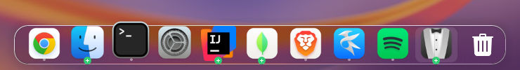

# plasma-liquid-glass

A "liquid glass" look for KDE Plasma 6 on top of the [WhiteSur](https://github.com/vinceliuice/WhiteSur-kde) theme:
see-through dock, top bar and popups with lens refraction, a thin rim light, 20px corners, and separate light and
dark tuning.

It is made of three parts:

- **A KWin effect** — a [fork of Better Blur DX](https://github.com/artyommargaryan/kwin-effects-better-blur-dx/tree/glass)
  that adds the glass lens, rim light, dock blur and backdrop dimming. Built from source by the installer.
- **Theme files** — replacement dock/top-bar and popup artwork for the WhiteSur and WhiteSur-dark Plasma themes
  (thin tints, 20px corners, matching blur masks and shadows).
- **Scripts** — light/dark switching that keeps a set of glass values per mode, a login check for KWin updates,
  and a one-command rebuild.

## Status

Built and tested on **one machine**: Fedora 44, Plasma/KWin 6.8.2, Wayland, two 1080p screens. The installer's file
and settings steps are also tested against an empty home directory; the full install on a second machine is not.
Other distributions should work but need their build dependencies installed by hand. X11 is untested.

## Requirements

- KDE Plasma 6 on Wayland
- The WhiteSur Plasma themes (`WhiteSur` and/or `WhiteSur-dark`) from [WhiteSur-kde](https://github.com/vinceliuice/WhiteSur-kde)
- `git`, `cmake`, a C++ compiler and the KWin development packages (the installer installs these on Fedora)
- `qdbus-qt6` (Fedora: `qt6-qttools`)

## Install

    git clone https://github.com/artyommargaryan/plasma-liquid-glass.git
    cd plasma-liquid-glass
    ./install.sh

The installer asks for `sudo` twice at most: for build dependencies (Fedora only) and to install the compiled effect
into `/usr`. Everything else goes into your home directory. It then restarts the Plasma shell so the new artwork shows.

Options: `--skip-deps` (dependencies already installed, or not on Fedora), `--skip-effect` (theme files, scripts and
settings only), `--no-reload` (do not touch the running session).

On a non-Fedora system, install the dependencies from the
[effect's README](https://github.com/artyommargaryan/kwin-effects-better-blur-dx/tree/glass#building) first, then run
`./install.sh --skip-deps`.

What it changes:

| What | Where | Original kept as |
|---|---|---|
| Compiled effect, id `better_blur_dx_local` | `/usr` (KWin plugin dirs) | — |
| Effect source | `~/.local/share/plasma-liquid-glass/kwin-effect` | — |
| Popup and dock artwork | `~/.local/share/plasma/desktoptheme/WhiteSur{,-dark}/` | `*.pre-liquid-glass` next to each file |
| Glass settings, stock blur off | `~/.config/kwinrc` | `~/.config/kwinrc.pre-liquid-glass` |
| `macos-theme-toggle`, `glass-blur-guard`, `glass-blur-rebuild` | `~/.local/bin/` | — |
| Login check | `~/.config/autostart/glass-blur-guard.desktop` | — |
| Light/dark watcher | `~/.config/systemd/user/macos-theme-sync.{path,service}` | — |

### Panel setup

The installer does not touch your panel layout. For the intended look, in each panel's edit mode:

- **Dock:** a bottom panel, *Floating*, width *Fit content*, opacity *Translucent*.
- **Top bar:** Floating → **Applets only**. The bar stays attached to the screen edge while its popups float, which
  gives them four round corners.

## After a KWin update

A KWin effect only loads into the exact KWin version it was built against, so every KWin update switches the glass
effect off. At the next login `glass-blur-guard` notices, turns the stock blur on for that session and shows a
notification. To get glass back:

    glass-blur-rebuild

## Light and dark

Use Plasma's own Dark Mode switch, or `macos-theme-toggle [light|dark|toggle]`. Either way the colour scheme, Plasma
theme, icons, Kvantum theme, GTK theme and the glass values change together; missing pieces are skipped with a warning.
Plasma's switch needs two Global Themes that select `WhiteSur` and `WhiteSurDark`; the watcher fills in the rest.

Each mode keeps its own glass values in `~/.config/glassblurmodesrc`, so tuning done in one mode stays with that mode.
To bind a key, add a shortcut for `macos-theme-toggle` in System Settings → Shortcuts.

## Tuning

System Settings → Desktop Effects → *Better Blur DX (local build)* → configure → **Glass** tab has sliders for
everything. The defaults are in [`glass-settings.conf`](glass-settings.conf); the keys are explained in the
[effect's GLASS.md](https://github.com/artyommargaryan/kwin-effects-better-blur-dx/blob/glass/GLASS.md).

To change a value from a terminal and apply it without logging out:

    kwriteconfig6 --file kwinrc --group Effect-better-blur-dx --key BlurStrength 6
    qdbus-qt6 org.kde.KWin /KWin reconfigure
    qdbus-qt6 org.kde.KWin /Effects org.kde.kwin.Effects.reconfigureEffect better_blur_dx_local

## Editing the artwork

The theme files are generated, not hand-drawn; the generators are in [`tools/`](tools) (Python 3, `panel_shadow.py`
and `bounds.py` need PySide6). Each takes an unpacked `.svg` and writes an `.svgz`:

    gen_dialog.py   R in.svg out.svgz [maskInset]     popup frame with corner radius R
    gen_dock.py     R in.svg out.svgz [maskInset]     dock ("south-" prefix) pieces with corner radius R
    panel_shadow.py R in.svgz out.svgz                shadow corners that follow radius R
    dock_border.py  R edge lit back in.svgz out.svgz [shadeWidth shadeOpacity]   light line round the dock
    kv_menu.py      R in.svg out.svg [border outline SH]   menu frame of a Kvantum theme (plain .svg in and out)

### Application menus (Kvantum)

Menus are drawn by Kvantum, not by the Plasma theme, and the installer does not touch your Kvantum theme.
To give them the same glass with clean round corners, in a copy of the dark Kvantum theme under `~/.config/Kvantum/`:

    python3 tools/kv_menu.py 8 Theme.svg Theme.svg.new 0 0 4      # then replace Theme.svg with the result

and in its `.kvconfig`: `[Menu] frame.top/bottom/left/right=15`, `menu_blur_radius=10`, `reduce_menu_opacity=0`
(the script bakes the translucency into the art; Kvantum's own fade also fades the shadow at the corners).
`MenuCornerRadius=10` and `MenuEdgeLine=40` from `glass-settings.conf` do the rest. Restart apps, and the Plasma
shell for global-menu popups, to see it. Shadow strength: `KV_SHADOW` (default 0.1).

The body colour and translucency are set with `KV_FILL` and `KV_FILLOP` (defaults: the theme's own colour at 0.2).
For a light theme whose Plasma popups are dark glass with light text, give the menu the same tint as the popup
frame (for example `KV_FILL='#f4f4f4' KV_FILLOP=0.16`) and set `text.normal.color` and
`text.normal.inactive.color` to a light colour in `[Menu]` and `[MenuItem]`. Icons from a light icon theme stay dark.

After replacing a theme file: `rm ~/.cache/ksvg-elements` and `systemctl --user restart plasma-plasmashell.service`.
Switching the Plasma theme away and back is not enough.

## Known limits

- The top bar is one glass strip, not separate pills, and buttons inside popups are not individually glass.
- Apps that set their own colours (browsers, terminals) do not follow the light/dark switch.
- The light theme draws white text, so the glass dims bright backdrops to keep it readable.

## Uninstall

    ./uninstall.sh

Restores the original theme files, switches the stock blur back on and removes the scripts and units. It prints the
command to remove the compiled effect from `/usr`.

## Credits and licence

- [Better Blur DX](https://github.com/xarblu/kwin-effects-better-blur-dx) by xarblu and contributors — the effect this builds on.
- [WhiteSur-kde](https://github.com/vinceliuice/WhiteSur-kde) by vinceliuice — the theme files in `theme/` are modified copies of its artwork.
- [liquid-glass](https://github.com/ryohsuke1231/liquid-glass) (GNOME extension) and [hyprglass](https://github.com/hyprnux/hyprglass) — the look and the lens technique.

GPL-3.0, see [LICENSE](LICENSE).
